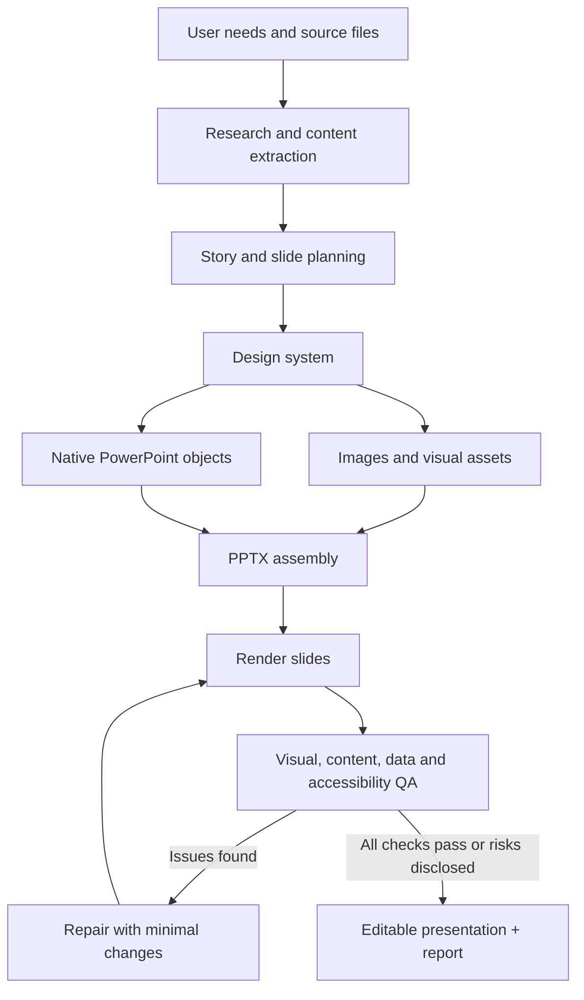

# Legend-Level PPT Skills

**Deterministic, research-grounded PowerPoint engineering plugin & skills for AI agents.**

Compatible across **Claude Code**, **OpenAI Codex**, **Cursor**, **Cline**, **OpenCode**, **OpenClaw**, **Devin**, and **Gemini CLI**.

This repository combines a comprehensive 55-source research handbook with executable agent skills for creating, surgically editing, inspecting, and repairing native Microsoft PowerPoint (`.pptx`) presentations.

> **Current status: Production-Ready Multi-Agent Skills & Research Knowledge Base.**

---

## ⚡ Quick Start: Multi-Agent Installation

| Environment | Installation / Usage |
|---|---|
| **Claude Code** | Load via `.claude-plugin/plugin.json` or add repository URL to plugins |
| **OpenAI Codex** | Loaded via `.codex-plugin/plugin.json` and `.agents/rules/` |
| **Cursor** | Native rules active in `.cursor/rules/legend-ppt.mdc` |
| **Cline / Roo Code** | Governed by `.clinerules/legend-ppt.md` |
| **OpenCode** | Supports native commands in `.opencode/command/` (`/legend-ppt`, `/legend-ppt-edit`) |
| **OpenClaw** | Skills auto-discovered in `.openclaw/skills/` |
| **Gemini CLI / Antigravity** | Defined via `gemini-extension.json` and `plugin.json` |

---

## 🛠️ The 5 Core Runnable Skills

1. **[`/legend-ppt`](skills/legend-ppt/SKILL.md):** Complete end-to-end presentation authoring from outlines or documents. Enforces action titles, design-system tokens, and native OOXML charts/tables.
2. **[`/legend-ppt-edit`](skills/legend-ppt-edit/SKILL.md):** Surgical, in-place reference deck editing. Updates numbers, dates, or slides while preserving 100% of masters, custom fonts, layouts, and untouched slides.
3. **[`/legend-ppt-qa`](skills/legend-ppt-qa/SKILL.md):** Automated visual linting and repair. Detects bounding-box text clipping, object collisions, low contrast, and unapproved fonts.
4. **[`/legend-ppt-audit`](skills/legend-ppt-audit/SKILL.md):** Deep audit of any `.pptx` file. Extracts color palettes and font scales, scores accessibility, and identifies bloat.
5. **[`/legend-ppt-motion`](skills/legend-ppt-motion/SKILL.md):** Motion and kinetic presentation choreography using GSAP, Remotion, and kinetic typography.

---

## Mission

Help AI agents create, edit, inspect, validate, and repair professional, editable, accessible PowerPoint presentations—not merely generate slides that look plausible in a screenshot.

## Start here

1. [Research status and evidence rules](research/00-research-methodology.md)
2. [Executive overview and product thesis](research/01-executive-overview.md)
3. [User problem taxonomy](research/02-user-problems/README.md)
4. [End-to-end presentation pipeline](research/03-presentation-pipeline.md)
5. [Technical architecture](research/04-technical-architecture.md)
6. [Design systems](research/05-design-systems/README.md)
7. [Image generation and assets](research/06-image-generation/README.md)
8. [PowerPoint object engineering](research/07-powerpoint-engineering/README.md)
9. [Rendering, QA, and repair](research/08-quality-assurance/README.md)
10. [Competitor landscape](research/09-competitor-analysis.md)
11. [Benchmark and evaluation plan](research/10-evaluation-plan.md)
12. [Glossary](research/11-glossary.md)
13. [Source register](research/12-sources.md)

## Research map

## Principles

- Evidence before assumptions.
- Cite primary documentation wherever possible.
- Separate observed facts, user reports, hypotheses, and recommendations.
- Preserve editability wherever practical.
- Never silently alter source data.
- Never claim a slide deck is verified unless checks actually ran.
- Keep original files and make repairs reversible.
- Treat accessibility, licensing, privacy, and security as product requirements.

## Research evidence labels

| Label | Meaning |
|---|---|
| **Primary source** | Official documentation, standards, API references, source code |
| **User report** | Individual discussion or complaint; not necessarily representative |
| **Measured result** | Reproducible experiment with method and artifacts |
| **Hypothesis** | Plausible explanation requiring validation |
| **Recommendation** | Proposed product or engineering decision |

## Contribution

Please add sources, issue reproductions, test decks, render comparisons, and benchmark results. Follow [CONTRIBUTING.md](CONTRIBUTING.md). Do not submit unsourced claims as established facts.

## License

Research text and original materials are licensed under the MIT License unless otherwise stated. External assets and quoted materials retain their respective licenses and attribution requirements.

## Ten-skill research

14. [Ten presentation and image skill reviews](research/15-skill-reviews/README.md)
15. [Side-by-side comparison of all ten](research/16-ten-skill-comparison.md)
16. [Recommended hybrid: what we should adopt](research/17-our-recommended-hybrid.md)
17. [External skill source register](research/18-skill-source-register.md)

These reviews are documentation-based as of 2026-11-21, not controlled output benchmarks. Read the limitations before treating any conditional winner as objectively best.

## Reference-based PPT editing

18. [Deep research: reference-based PowerPoint recreation and data replacement](research/19-reference-based-ppt-recreation.md)
19. [Operational workflow and engineering contract](research/20-reference-deck-workflow-spec.md)
20. [Reference edit manifest JSON Schema](schemas/reference-edit-manifest.schema.json)

This capability is designed for users who upload an existing deck and want new information inserted while its original structure and styling are preserved. It prioritizes minimal native-object edits, a change manifest, rendering, data validation and visual QA.

## Claude presentation workflow research

21. [Deep research: how Claude creates presentations, designs and visual assets](research/21-claude-presentation-workflow-research.md)
22. [What we should adopt from Claude](research/22-methods-to-adopt-from-claude.md)

This research separates Claude for PowerPoint, Claude Slides, Claude Design and the public PPTX skill; documents design systems, slide planning, native charts/diagrams, image-generation limitations, integrations and quality assurance.

## External design-skill repository research

23. [Nineteen-repository research handbook](research/23-external-design-skill-research/README.md)
24. [Cross-repository patterns](research/23-external-design-skill-research/10-cross-repository-patterns.md)
25. [Frameworks, libraries and tools map](research/23-external-design-skill-research/11-frameworks-libraries-tools.md)
26. [What to adopt for our PPT system](research/23-external-design-skill-research/12-what-to-adopt-for-ppt.md)
27. [Source and license register](research/23-external-design-skill-research/13-source-and-license-register.md)

The design-skill handbook inventories 807 `SKILL.md` paths across the first nine repositories. The wider research now covers 19 repositories, including presentation engines and motion/video systems; each is separated by what it can actually generate or edit.

### Additional presentation-engine research

- [PPT Master deep dive](research/23-external-design-skill-research/14-ppt-master.md)
- [Frontend Slides deep dive](research/23-external-design-skill-research/15-frontend-slides.md)
- [PPT Agent Skill deep dive](research/23-external-design-skill-research/16-ppt-agent-skill.md)
- [Slides AI Plugin deep dive](research/23-external-design-skill-research/17-slides-ai-plugin.md)
- [Four-repository comparative synthesis](research/23-external-design-skill-research/18-four-repo-comparative-synthesis.md)

The external repository handbook now covers 19 repositories in total.

### Motion design and video research

- [GSAP Skills deep dive](research/23-external-design-skill-research/19-gsap-skills.md)
- [Remotion Skills deep dive](research/23-external-design-skill-research/20-remotion-skills.md)
- [LottieFiles Motion Design Skill deep dive](research/23-external-design-skill-research/21-lottiefiles-motion-design-skill.md)
- [iArt Motion Skills collection deep dive](research/23-external-design-skill-research/22-iart-motion-skills.md)
- [Framer Motion Skills deep dive](research/23-external-design-skill-research/23-framer-motion-skills.md)
- [Awesome Motion Design Agent Skills deep dive](research/23-external-design-skill-research/24-awesome-motion-design-agent-skills.md)
- [Six-repository motion synthesis and PPT adaptation](research/23-external-design-skill-research/25-six-motion-repo-comparative-synthesis.md)

The motion research distinguishes browser animation, deterministic video, Lottie media and native PowerPoint animation. These are separate output technologies, not interchangeable implementations.
