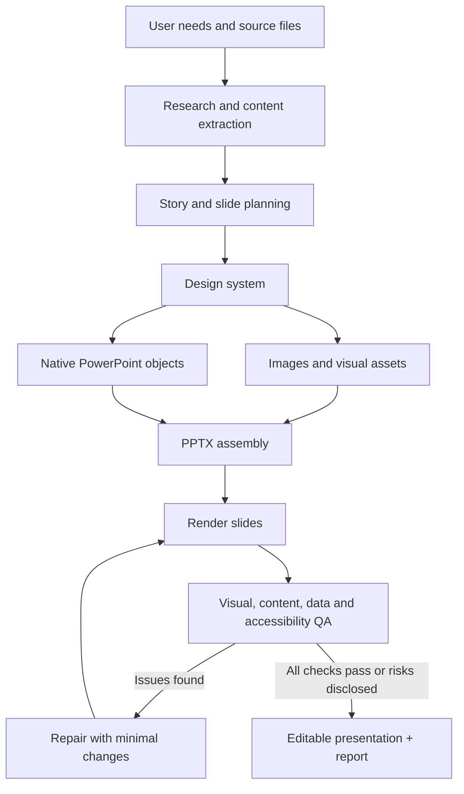

# Legend-Level PPT Skills

**Research-first, open-source knowledge base for building reliable AI presentation skills.**

This repository documents the full presentation-engineering problem space: user pain points, presentation design, narrative, typography, color, image generation, PowerPoint objects, PPTX internals, rendering, accessibility, validation, repair, agent-skill design, competitor analysis, and evaluation.

> **Current status: Research foundation / planning.** This repository is not yet a finished presentation-generation skill. It is a structured research handbook intended to guide evidence-based implementation.

## Mission

Help AI agents create, edit, inspect, validate, and repair professional, editable, accessible PowerPoint presentations—not merely generate slides that look plausible in a screenshot.

## Start here

1. [Research status and evidence rules](research/00-research-methodology.md)
2. [Executive overview and product thesis](research/01-executive-overview.md)
3. [User problem taxonomy](research/02-user-problems/README.md)
4. [End-to-end presentation pipeline](research/03-presentation-pipeline.md)
5. [Technical architecture](research/04-technical-architecture.md)
6. [Design systems](research/05-design-systems/README.md)
7. [Image generation and assets](research/06-image-generation/README.md)
8. [PowerPoint object engineering](research/07-powerpoint-engineering/README.md)
9. [Rendering, QA, and repair](research/08-quality-assurance/README.md)
10. [Competitor landscape](research/09-competitor-analysis.md)
11. [Benchmark and evaluation plan](research/10-evaluation-plan.md)
12. [Glossary](research/11-glossary.md)
13. [Source register](research/12-sources.md)

## Research map

## Principles

- Evidence before assumptions.
- Cite primary documentation wherever possible.
- Separate observed facts, user reports, hypotheses, and recommendations.
- Preserve editability wherever practical.
- Never silently alter source data.
- Never claim a slide deck is verified unless checks actually ran.
- Keep original files and make repairs reversible.
- Treat accessibility, licensing, privacy, and security as product requirements.

## Research evidence labels

| Label | Meaning |
|---|---|
| **Primary source** | Official documentation, standards, API references, source code |
| **User report** | Individual discussion or complaint; not necessarily representative |
| **Measured result** | Reproducible experiment with method and artifacts |
| **Hypothesis** | Plausible explanation requiring validation |
| **Recommendation** | Proposed product or engineering decision |

## Contribution

Please add sources, issue reproductions, test decks, render comparisons, and benchmark results. Follow [CONTRIBUTING.md](CONTRIBUTING.md). Do not submit unsourced claims as established facts.

## License

Research text and original materials are licensed under the MIT License unless otherwise stated. External assets and quoted materials retain their respective licenses and attribution requirements.
