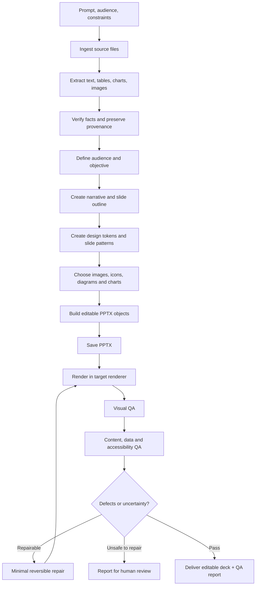

# End-to-End Presentation Pipeline

**Status:** Architecture model  
**Last reviewed:** 2026-11-21

## Stage 1: Intake

Capture purpose, audience, desired decision, presentation type, length, speaking duration, slide size, brand/template, source files, language, citations, confidentiality, output, and compatibility targets.

## Stage 2: Ingestion

Extract content while tracking original filename and page/sheet/slide, spreadsheet ranges, tables/charts, images/captions, dates, units, currencies, ambiguity, and source traceability. Never invent missing figures.

## Stage 3: Story

Each planned slide should have an objective, main message, evidence, visual form, source references, speaker notes (if requested), and transition.

## Stage 4: Design

Define canvas, margins, grid, spacing, color roles, font families, type scale, line weights, chart palette, image treatment, and recurring components.

## Stage 5: Asset/object selection

Prefer editable semantic objects when useful: native text, charts, shapes, tables and connectors. Use SVG for suitable vector art and raster imagery for photography or complex artwork.

## Stage 6: Render and QA

A successful save does not establish correctness. Render all slides and inspect them. Run structural, factual, accessibility, and compatibility checks. Record renderer/version.

## Stage 7: Repair

Identify exact slide/object, cause, confidence, and smallest safe change. Preserve source data and editability; write a new file by default; rerender; check regressions; report unresolved issues.
