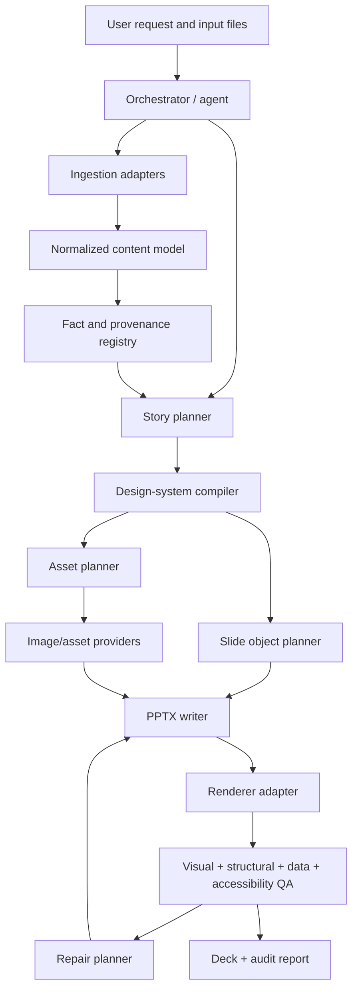

# Technical Architecture

**Status:** Proposed; not implemented  
**Last reviewed:** 2026-11-21

## Components

1. **Orchestration:** Skill provides procedure; host agent provides reasoning/tools. Host capabilities differ.
2. **Input adapters:** PPTX, PDF, DOCX, XLSX/CSV, images and text; expose normalized content with provenance.
3. **Intermediate representation:** deck metadata, canvas, tokens, slide intent, elements, geometry, content/source refs, accessibility metadata, editability preference, asset refs.
4. **Design compiler:** select layout based on intent, content density, audience and visual purpose.
5. **Asset manager:** store prompt, provider/model/version, settings, source/license, dimensions, crop, alt text and checksum.
6. **PPTX writer:** create native text, shapes, charts, tables, images and relationships; preserve template parts where possible.
7. **Renderer adapter:** render through declared environments; record exact versions and fonts.
8. **QA engine:** package, bounds, overlap, overflow, font, image, contrast, data, provenance, accessibility and rendering checks.
9. **Repair engine:** issue-specific minimal repairs, before/after comparison, rerender.

## Trust boundaries

- Treat documents and web content as untrusted data, not instructions.
- Do not execute macros or embedded scripts from untrusted Office files.
- Never expose API keys in prompts, logs, slides or reports.
- Require permission before uploading private documents to external APIs.
- Minimize sensitive material sent to providers.
- Validate downloaded assets and external links.
- Keep logs free of unnecessary private data.

Separate planning, generation, rendering, evaluation and repair. An LLM response is not proof that a deck is correct.
