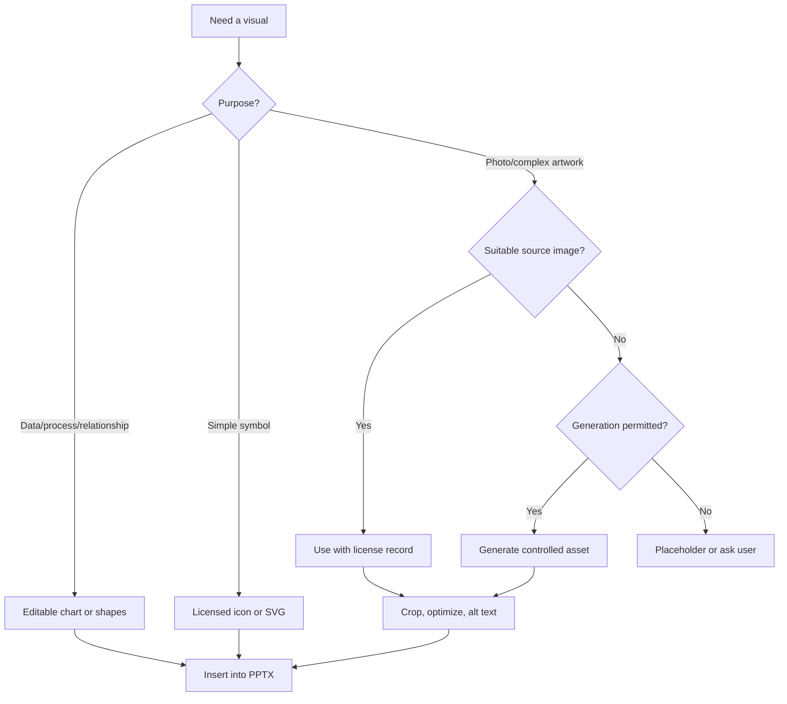

# Image Generation and Visual Assets

Topic map:
- [Generation workflow](workflow.md)
- [Prompt engineering](prompt-engineering.md)
- [Asset management, cropping and placement](asset-management.md)
- [Licensing, privacy and provenance](licensing-and-provenance.md)

Do not generate every visual. Charts, flowcharts, timelines, tables and simple diagrams are often better as native editable objects.