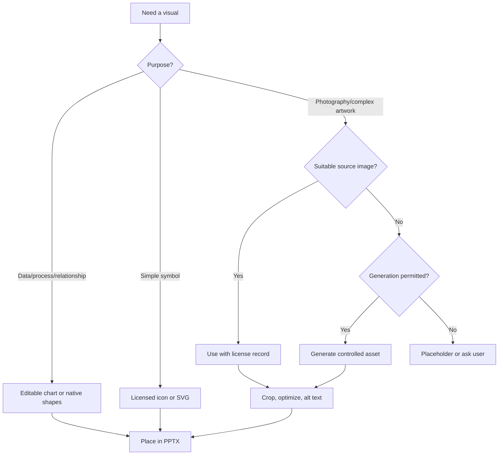

# Image Generation and Visual Assets

**Status:** Research map  
**Last reviewed:** 2026-11-21

- [Image generation workflow](workflow.md)
- [Prompt engineering](prompt-engineering.md)
- [Asset management, cropping and placement](asset-management.md)
- [Licensing, privacy and provenance](licensing-and-provenance.md)

## Asset decision

Do not generate every visual. Charts, flowcharts, timelines, tables and simple diagrams are often better as native editable objects.
