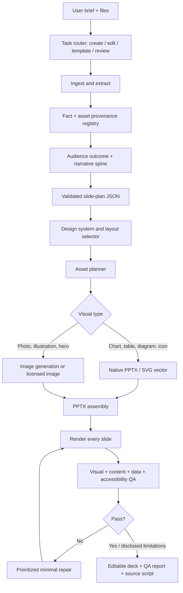

# Recommended Hybrid — What We Should Learn and Build

**Status:** Design recommendation based on ten source reviews; not yet implemented.  
**Reviewed:** 2026-11-21

## Product goal
Create one agent skill that reliably produces presentations from a brief and source material, with native editable PPTX as the default professional deliverable, optional HTML/image-first output, controlled image generation, and a real quality-assurance loop.

## Best ideas borrowed conceptually

| Source | Adopt the idea | How we adapt it |
|---|---|---|
| Knowledge Cat PPT | Audience shift, story spine, action titles, output routing, plan validation, editability probes | Make these the core orchestration workflow |
| PPT Master | Generate/edit/template modes; source conversion; brand-template extraction | Add three explicit task routes |
| slides-skill | JSON deck plan; deterministic renderer; slide-type catalog; contact-sheet QA | Use a validated intermediate representation |
| slide-maker | Template previews, native editable output, saved build script, independent critic | Build a curated style gallery and reproducible project folder |
| PPT Generator | Design specs, SVG compatibility rules, reusable chart/icon catalog | Use constrained vector authoring only where conversion is tested |
| AgentBuff | Visual style previews, density modes, canonical source and explicit fidelity/editability trade-off | Let users preview design directions; never silently flatten PPTX |
| Presentation Agent Skills | Modular specialist responsibilities; visual art direction; restoration; dedicated QA | Separate narrative, visuals, build, restore and QA modules |
| Dashi PPT | Multiple layout candidates; canonical content separate from layout variants; media slot validation | Create alternatives from one canonical slide content object |
| OpenAI ImageGen | Raster-vs-vector routing, prompt structure, reference/edit distinction, inspect/iterate, non-destructive saves | Use only for imagery that benefits from raster generation |
| Leonxlnx imagegen | Consistent image families and brand boards | Establish deck-level art direction before generating multiple images |

## Our differentiator
Do not compete by adding 100 templates. Build a verifiable presentation workflow that is:
- Source-grounded: every material claim/value can be traced to its input.
- Story-first: slides have a purpose and action title.
- Design-aware: layouts are selected by semantic intent and visual hierarchy.
- Editable: native objects are used when the user needs to revise content.
- Honest: the system labels flattened images and approximations.
- Tested: every slide is rendered and checked.
- Repairable: small changes are applied, then the whole deck is rechecked.
- Safe: assets, API keys, private files and licenses are handled responsibly.

## Proposed architecture

## Recommended end-to-end behavior

### 1. Request routing
- Create from topic/content.
- Convert source documents into slides.
- Edit existing PPTX while preserving its template.
- Extract a reusable template from a reference deck.
- Review/repair a deck without changing it unless asked.

### 2. Brief and story
Collect only details that materially change the output: audience, purpose/decision, source material, speaking vs reading deck, output format, slide count, brand constraints and deadline. Infer safe defaults; ask concise questions only when essential.

Create:
- Audience and desired shift.
- Main promise.
- Scope and evidence requirements.
- Narrative spine.
- Action titles.
- Slide-by-slide role, message, evidence, visual and source refs.

### 3. Structured deck plan
Use JSON as a contract between reasoning and rendering. Include:
- Deck metadata and canvas.
- Design tokens.
- Slide ID, role, action title, content, sources and notes.
- Layout type and object definitions.
- Chart data and units.
- Image slot, prompt, aspect ratio and alt text.
- Editability requirement.
- QA expectations.

Validate schema before generation. Canonical content must be stored once; layout variants should reference it rather than duplicating and drifting.

### 4. Design system
Create style previews with distinct art directions. A design preset defines:
- Palette roles, not just a list of hex values.
- Font families/fallbacks and type scale.
- Grid, margins and spacing.
- Layout families and chart palette.
- Image treatment and background texture.
- Footers, page numbers and source styles.

Use the selected system consistently, but vary layout based on slide purpose.

### 5. Visual asset routing
- Native chart for numeric data.
- Native shapes for process, timeline, matrix and simple diagrams.
- SVG/vector for icons and scalable simple illustrations.
- Generated/routed image for photography, complex illustration, concept art and hero visuals.
- Never ask image models to render accurate chart labels or tables.
- Record source, license, provider/model, prompt, date, dimensions and alt text.
- Keep images stylistically consistent across the deck.

### 6. PowerPoint construction
Default to native editable text, shapes, charts, tables and connectors. Embed raster assets only for visuals that need them. Preserve masters, layouts, theme and unchanged slides in edit mode. Keep the generation source/spec alongside the exported deck.

### 7. QA gates
Run:
- Package/openability checks.
- Text extraction and placeholder detection.
- Bounds/overlap/overflow candidates.
- Render every slide and create a contact sheet.
- Inspect suspicious slides full size.
- Verify chart values and units against source.
- Check image crop/resolution and broken media.
- Check fonts, contrast, alt text, title and reading order.
- Verify expected editability.
- Run a fix-and-render regression pass.

Report what was actually tested, renderer/version and unresolved risks. Do not label a deck "perfect".

## MVP recommendation

Do not implement every advanced feature at once. First build:
1. A concise SKILL.md with routing and workflow.
2. A JSON deck-plan schema and validator.
3. A deterministic native PPTX renderer with 8-12 core slide types.
4. A curated set of 6-8 excellent themes, each with explicit tokens.
5. A rendering/contact-sheet script.
6. A QA report for overflow, missing assets, placeholders and chart/data mismatch.
7. A separate image prompt planner and asset manifest.
8. A small benchmark corpus with expected outputs and human rubric.

Only then add template extraction, native PPTX editing, animations, narration, HTML export, screenshot restoration and multi-agent critic orchestration.

## Non-negotiable engineering decisions
- Never claim full editability without inspecting object structure.
- Never treat an image-per-slide PPTX as editable.
- Never let an image model create authoritative numeric chart content.
- Never silently invent sources, facts, data or citations.
- Never shrink text until unreadable to force fit.
- Never modify source files in place by default.
- Never ship without rendering the final deck.
- Never copy competitor code/assets without license review.

## Benchmark before declaring the hybrid "best"
Use identical source packs and prompts across candidate skills. Score story, factual fidelity, visual quality, editability, accessibility, rendering compatibility, reliability, runtime and human correction time. Publish test artifacts and failure cases. This is the only defensible way to claim our hybrid outperforms alternatives.